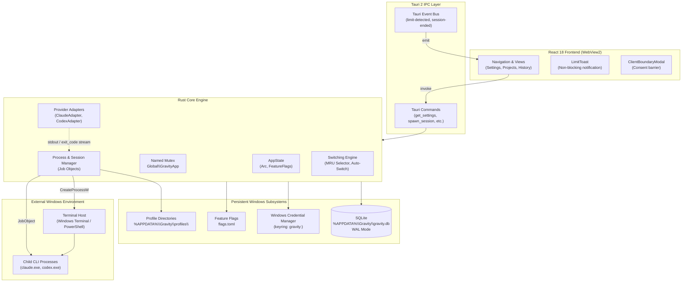
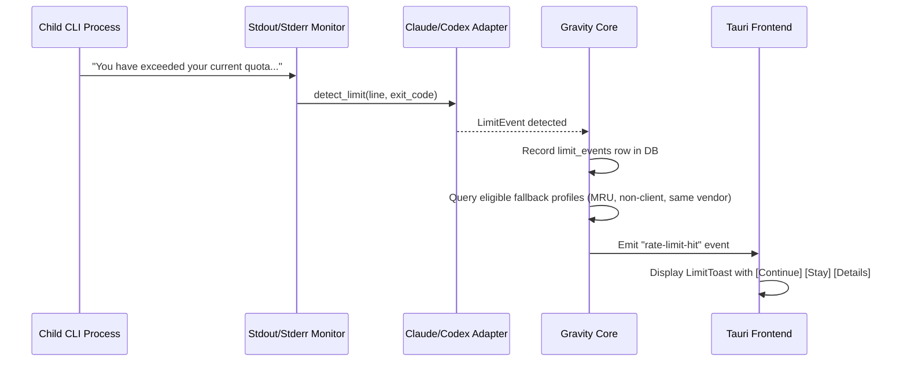

# Gravity Architecture & System Specification

> **Version:** 0.1.0  
> **Target OS:** Windows 10 (build 19041+) / Windows 11  
> **Subsystem:** Tauri 2 (WebView2) + Tokio (Rust) + Win32 API

---

## 1. System Topology



---

## 2. Windows Isolation & Process Model

### 2.1 Environmental Isolation
Gravity guarantees CLI credential isolation at the OS environment variable layer:
- **No Global Token Pollution:** The user's system and user environment variables (e.g. `ANTHROPIC_API_KEY`, `OPENAI_API_KEY`) are stripped out when generating the child environment block.
- **Dedicated Profile Dirs:**
  - For Claude Code: `CLAUDE_CONFIG_DIR = %APPDATA%\Gravity\profiles\<uuid>`
  - For Codex CLI: `CODEX_HOME = %APPDATA%\Gravity\profiles\<uuid>`
- The child process inherits only baseline OS system variables (`PATH`, `SYSTEMROOT`, `TEMP`, `USERPROFILE`) plus the designated vendor config directory.

### 2.2 Process Tree & Win32 Job Objects
To prevent zombie CLI instances upon unexpected termination or application shutdown:
1. Every new terminal/session invocation spawns a dedicated Windows **Job Object** via `CreateJobObjectW`.
2. The job object is configured with `JOB_OBJECT_LIMIT_KILL_ON_JOB_CLOSE`:
   ```rust
   let mut info = JOBOBJECT_EXTENDED_LIMIT_INFORMATION::default();
   info.BasicLimitInformation.LimitFlags = JOB_OBJECT_LIMIT_KILL_ON_JOB_CLOSE;
   SetInformationJobObject(
       job,
       JobObjectExtendedLimitInformation,
       &info as *const _ as _,
       std::mem::size_of::<JOBOBJECT_EXTENDED_LIMIT_INFORMATION>() as u32,
   )?;
   ```
3. Child processes (`wt.exe` or `powershell.exe` and their sub-processes) are assigned to the Job Object via `AssignProcessToJobObject`.
4. When Gravity closes, the Job Object handles are closed by the OS kernel, terminating all descendant processes immediately.

### 2.3 Terminal Invocation Hierarchy
When a session is requested:
1. Gravity probes for Windows Terminal (`wt.exe` via `PATH` and `%LOCALAPPDATA%\Microsoft\WindowsApps\wt.exe`).
2. If available, Gravity invokes:
   ```cmd
   wt.exe -d "<project_path>" -- powershell.exe -NoExit -Command "<command>"
   ```
3. If `wt.exe` is unavailable, Gravity falls back to:
   ```cmd
   powershell.exe -NoExit -Command "Set-Location '<project_path>'; <command>"
   ```
4. A single warning notice is recorded if Windows Terminal is absent.

---

## 3. Data Architecture (SQLite)

The database is stored at `%APPDATA%\Gravity\gravity.db` with `PRAGMA journal_mode = WAL` and `PRAGMA foreign_keys = ON`.

### Schema Summary
- **`profiles`**: Stores profile identity (`id`, `label`, `vendor`, `tag`, `config_dir`, `cred_ref`, `is_active`). Secrets are **never** stored in SQLite.
- **`projects`**: Local repository paths (`id`, `path`, `name`, `tag`, `auto_switch_enabled`, `default_profile_id`, `terminal`).
- **`sessions`**: Active and completed terminal sessions (`id`, `profile_id`, `project_id`, `pid`, `started_at`, `ended_at`, `exit_code`, `status`).
- **`usage_readings`**: Point-in-time usage tracking (`id`, `profile_id`, `source`, `window`, `value_used`, `value_limit`, `unit`, `reset_at`, `detail`).
- **`limit_events`**: Detected rate limits (`id`, `session_id`, `profile_id`, `detected_at`, `source`, `raw_signal`, `detail`).
- **`switch_events`**: Audit log of switches (`id`, `session_id`, `from_profile_id`, `to_profile_id`, `project_id`, `reason`, `outcome`, `new_session_id`, `switched_at`).

---

## 4. Rate Limit Detection Pipeline



### Detection Heuristics:
1. **Claude Code Adapter:**
   - Detects stdout strings: `"rate limit"`, `"usage limit exceeded"`, `"429 Too Many Requests"`, `"credit balance is too low"`.
   - Inspects CLI exit codes: Exit code `1` accompanied by rate limit text.
2. **Codex Adapter:**
   - Detects stdout strings: `"Rate limit reached"`, `"insufficient_quota"`, `"Quota exceeded"`.
   - Inspects error JSON blocks outputted on stderr.

---

## 5. Security & Isolation Boundaries

1. **Client Boundary Guard:**
   - Any project tagged `client` is classified as restricted.
   - Gravity prohibits automated switching for `client` projects.
   - Any manual switch that enters or exits a `client` profile requires explicit confirmation via `ClientBoundaryModal`. The default button is **Cancel**.
2. **Credential Storage:**
   - API keys and tokens are stored in the Windows Credential Manager under the target name `gravity:<profile_uuid>`.
   - Keys are accessed only in memory when preparing the environment block for process launch.
3. **Log Scrubbing:**
   - The tracing subscriber explicitly filters and redacts environment strings matching `*KEY*`, `*TOKEN*`, `*SECRET*`.
